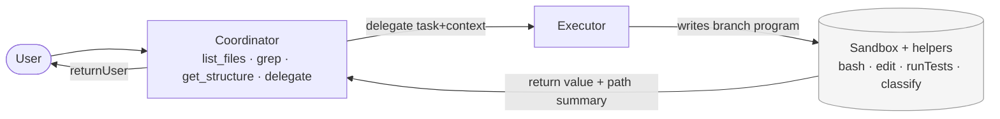

# AI Workflow

**Research harness for context-efficient coding agents.**

Three agentic coding strategies — differing in how much raw tool output enters model context — are evaluated against the same 9 Python repair/feature problems so pass rates and costs can be compared fairly.

The central thesis: keep raw file contents and raw tool output *out of context by capability, not by prompt instruction*. If a coordinator model has no `read_file` tool, it cannot accumulate file contents regardless of what the prompt says.



*Coordinator sees only structure. Raw tool output stays inside the sandbox. Only the return value and a compact path summary leave it.*

> **Note (2026-10-19):** The diagram above shows the planned **orchestrate-active** design. The current build uses a simpler passive-injection coordinator; see Modes below.

---

## Modes

| Mode | Description | Known limitation |
|------|-------------|-----------------|
| **baseline** | Standard atomic tools: Bash, Read, Edit, Write, Glob, Grep. Control condition. | No context isolation — every tool result appends to context. |
| **branch-only** | Model writes a short TypeScript program as a single `branch` tool call. Raw output stays inside the sandbox; only the return value enters context. | TypeScript cognitive overhead causes syntax errors and `returnUser` misuse. |
| **orchestrate** | Two-tier: coordinator LLM gets only `delegate`; secondary LLM writes branch programs. BM25 shortlist pre-injects relevant composite tools into secondary context. | File listing is pre-injected (passive) rather than discovered on demand. Secondary LLM token cost is currently untracked (see [issue 01](dev/issues/01-secondary-token-tracking.md)). |

### Planned: orchestrate-active

Replace passive file-listing injection with an active coordinator that uses a constrained tool set:
`list_files` · `grep` · `find_symbol` · `get_structure` · `delegate`

No `read_file` for the coordinator — the tool set enforces the constraint. A metered `attach(path, lines?)` escape hatch lets it pull a file excerpt when truly needed; attach rate becomes a logged metric.

---

## Results

| Mode | Pass / Total | Rate | Notes |
|------|-------------|------|-------|
| baseline | 20 / 27 | 74% | |
| orchestrate | 17 / 27 | 63% | |
| branch-only | 12 / 27 | 44% | |

*DeepSeek v3 · 9 problems × 3 runs · run `2026-10-18T05-39-00-582Z`*

**Contamination caveat:** `framework/prompt/orchestrate-system.md` contained per-problem hints (p04, p06, p07) that gave orchestrate an unfair advantage. Those hints were stripped on 2026-10-19. A clean rerun is needed before drawing conclusions — this is the top roadmap item.

**What is not yet measured:** Secondary LLM token cost and turn counts (`subCost`, `orchestrateTurns`) are always 0 in the current implementation. The claim that orchestrate is *cheaper* than baseline cannot be evaluated until [issue 01](dev/issues/01-secondary-token-tracking.md) is resolved.

---

## How this differs from related work

This project draws on ideas from several prior systems — Cloudflare Code Mode, Anthropic programmatic tool calling, CodeAct, smolagents, ReWOO, LLMCompiler, and RLM — detailed in [docs/PLAN.md](docs/PLAN.md). The table below describes where the design makes different choices.

| Prior work | How it differs here |
|---|---|
| **Claude Code subagents** | The parent session retains its full tool set; each subagent accumulates raw tool output in its own context. Here the executor writes programs that contain output inside a sandbox — only the return value leaves. |
| **Aider architect/editor mode** | The architect reasons over full file contents and has no tools; the split is reasoning vs. edit formatting. Here the coordinator is constrained by its tool set, not by prompt instruction. |
| **OpenHands DelegatorAgent** | A fixed state machine routes tasks to specialist agents; delegates use ordinary tools. Here the coordinator is itself an LLM and delegates write sandboxed programs. |

---

## Roadmap

1. **Secondary token accounting** — implement `subCost` and `orchestrateTurns` tracking ([issue 01](dev/issues/01-secondary-token-tracking.md))
2. **Clean rerun** — rerun all 9 problems after hint removal to get uncontaminated scores
3. **orchestrate-active + attach** — active coordinator tool set; metered `attach` escape hatch
4. **branch-python** — Python execution language instead of TypeScript ([issue 02](dev/issues/02-secondary-interface-language.md))
5. **Expand to ~25 problems** — broader coverage, including multi-file tasks
6. **Catalog-size scaling experiment** — measure whether BM25 context savings grow with tool catalog size ([issue 03](dev/issues/03-tool-selection-bm25.md))
7. **Provider-agnostic backend + per-tier model routing** — different models for coordinator vs. executor

---

## Layout

| Path | What |
|---|---|
| `framework/` | MCP server, sandbox runner, helpers, prompts, tests. See [framework/README.md](framework/README.md). |
| `experiments/` | Eval harness (`run.ts`) + 9 Python problems (`problems/0N-*/`). Outputs in `experiments/runs/<ts>/` (gitignored). |
| `experiments/viewer/` | Self-contained HTML dashboard. Build with `cd framework && npm run view`, then open `experiments/viewer/index.html`. |
| `dev/issues/` | Open design and implementation issues. |
| `dev/jobs/` | Specs for framework dev tasks. |
| `docs/` | Design documents. |

## Running

<details>
<summary>Setup and running experiments</summary>

```bash
# One-time setup (installs deps, generates config, runs tests):
cd framework && ./setup.sh

# After any code change:
cd framework && npm test && npx tsc -p .

# Full eval (requires an OpenAI-compatible endpoint):
OPENAI_BASE_URL=https://openrouter.ai/api/v1 OPENAI_API_KEY=<key> \
  npm run eval -- --problem all --mode compare --n 3 --model deepseek/deepseek-chat-v3-0324

# Retry only failed jobs from a prior run:
OPENAI_BASE_URL=https://openrouter.ai/api/v1 OPENAI_API_KEY=<key> \
  npm run eval -- --retry-failed <run-dir-timestamp> --mode orchestrate --n 3 --model deepseek/deepseek-chat-v3-0324

# View results:
cd framework && npm run view   # then open experiments/viewer/index.html
```

Experiments use `deepseek/deepseek-chat-v3-0324` via OpenRouter to keep per-run cost low; any OpenAI-compatible endpoint works.

**Mode flags:** `--mode compare` runs all three modes. `--mode both` runs baseline + branch-only. `--turns N` / `--orch-turns N` override the main-loop and secondary-LLM turn caps (defaults: 40 / 15).

Generated files (`framework/mcp.json`, `framework/settings.json`, `framework/prompt/.system.<mode>.md`) contain absolute paths and are not committed; `setup.sh` regenerates them.

</details>
